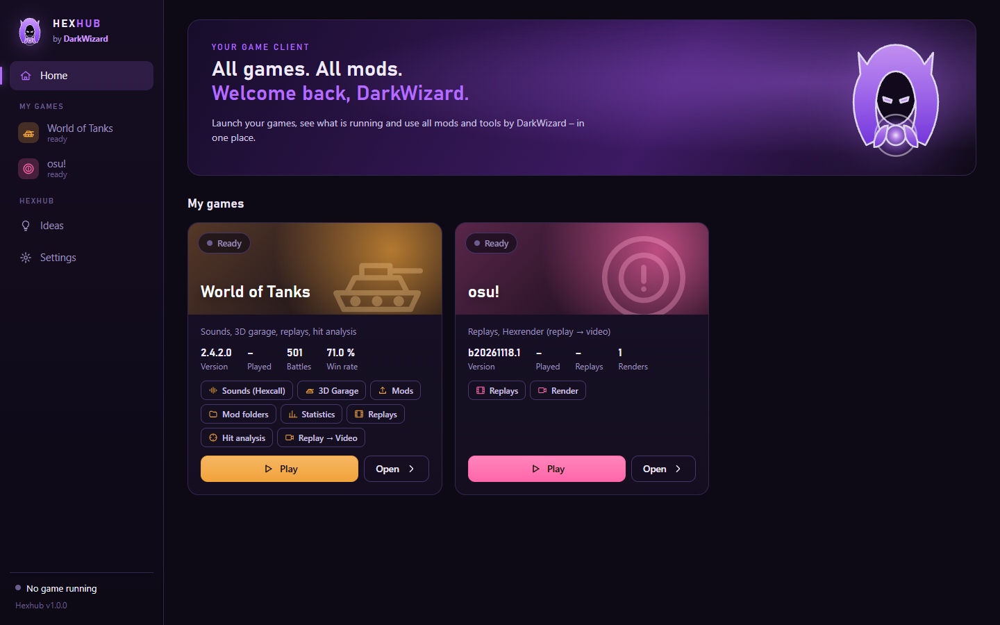
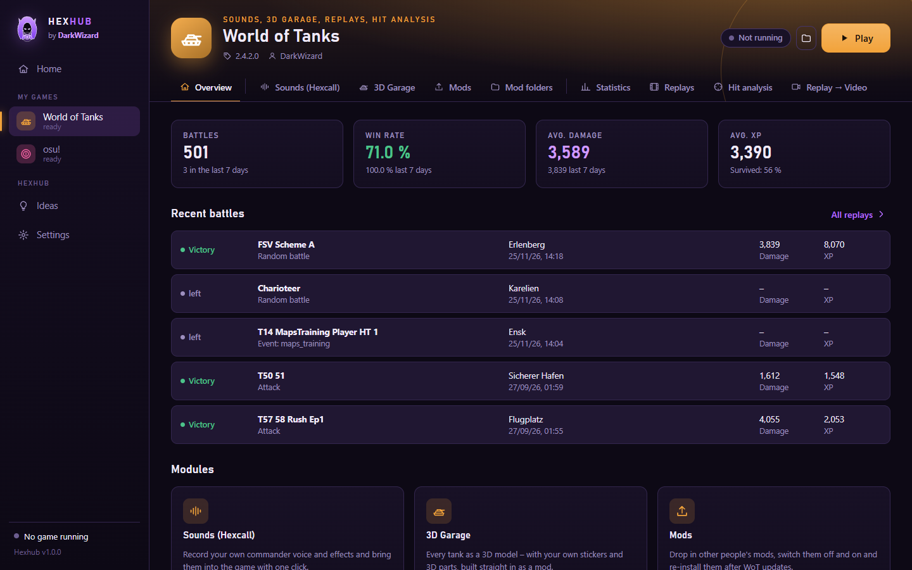
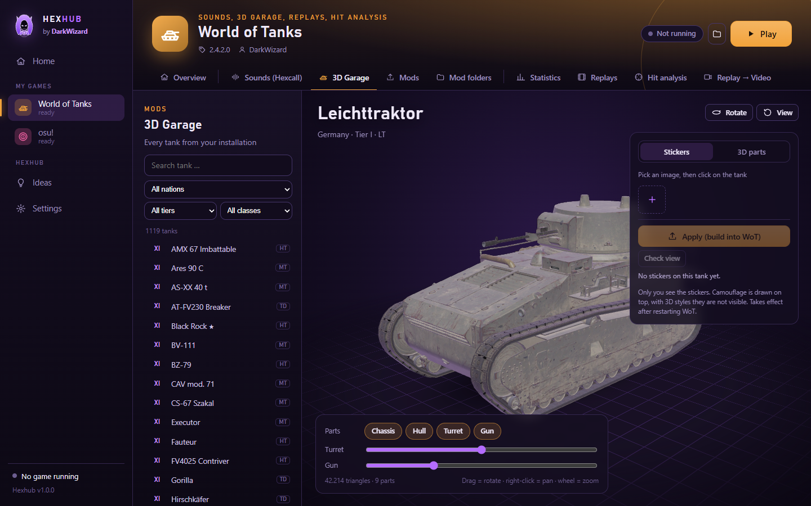
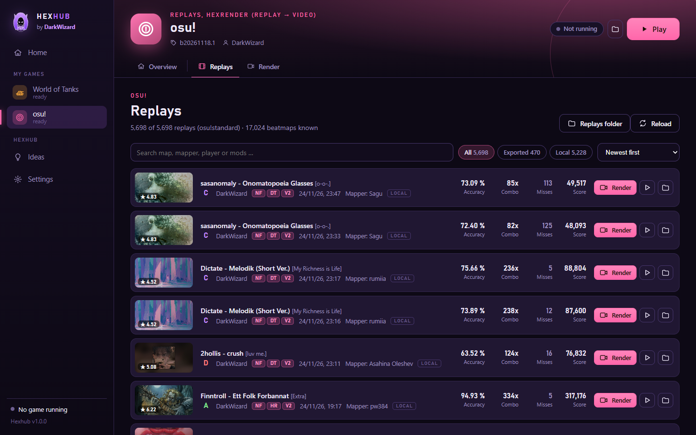
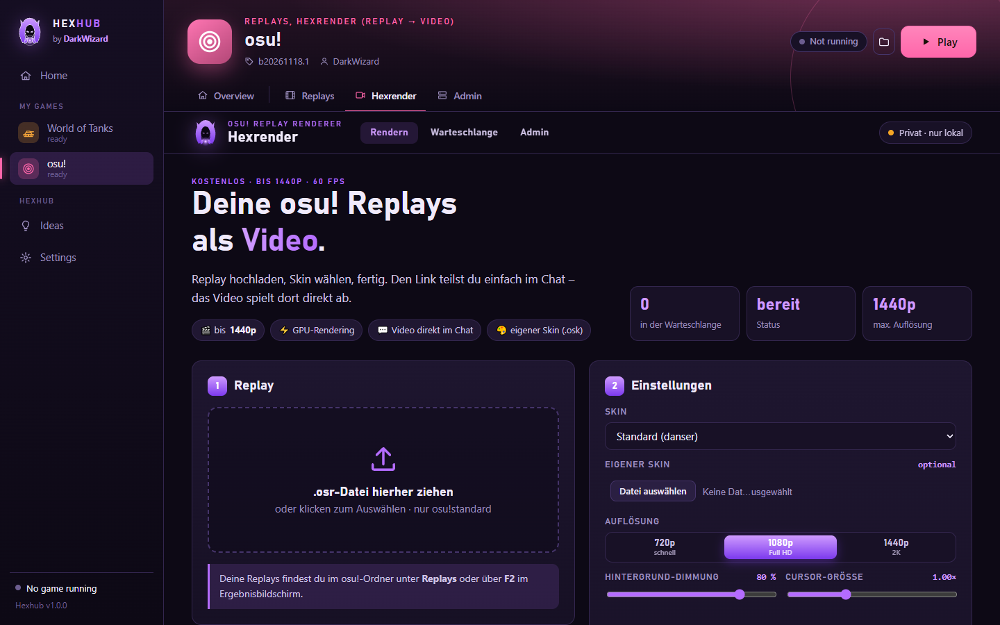

<p align="center"></p>

<h1 align="center">Hexhub</h1>
<p align="center"><b>One client for your games – launch them, see what's running and use all mods and tools by DarkWizard</b><br>
World of Tanks · osu! · more to come</p>

<p align="center"><a href="../../releases/latest"><b>⬇ Download the latest version</b></a> · <a href="https://d4rkwizard.github.io/hexhub/">Website</a></p>



Hexhub replaces the stand-alone **Hexcall** sound mod: Hexcall is now one tab of the World of Tanks page, next to everything else.

## Features

**Client**
- All your games in one place: **Play** and **Close** buttons, live "running for 12 min" status, play time
- A page per game with its own tabs – like a launcher, in the DarkWizard style
- Ideas list, 6 languages (English, German, Russian, Polish, French, Spanish), three themes
- Updates itself from GitHub Releases (checksum verified)

**World of Tanks**
- **Sounds (Hexcall):** record your own commander voice and sound effects with your microphone and switch them on in game – no Wwise needed
- **3D garage:** every tank of your installation as a 3D model; put your own **stickers** on it or attach **3D parts** (.glb/.gltf/.obj) and build them into the game as a mod (only you see them)
- **Mods:** drop in other people's mods (.wotmod/.zip/.7z/.rar) – Hexhub sorts them into the right folders, switches them off and on and re-installs them after WoT updates
- **Statistics & replays:** win rate, damage and XP per tank, map and mode – from your replay files; play replays in WoT with one click
- **Hit analysis:** whom you hit where (and who hit you) with shell and trajectory in 3D
- **Replay → video:** drop a replay, get an MP4 (recorded on a virtual monitor)

**osu!**
- **Replays:** all your replays (exported and local scores) with map, mods, accuracy, combo and background – search, sort, watch in osu!
- **Hexrender:** the Hexrender website right inside the client – render, queue and video pages exactly like on the web. "Render" in the replay list puts the replay straight into it; you get a link to the video that plays right inside Discord
- **Admin (operator only):** on the PC that runs the Hexrender server, Hexhub can start it and shows its admin page as its own tab

| | |
|---|---|
|  |  |
|  |  |

## Installation

1. Download the **installer** (`Hexhub-Setup-x.y.z.exe`) or the **ZIP** from [Releases](../../releases/latest).
2. Run the installer, or unzip the ZIP and start `Hexhub.vbs`.
3. Windows may show "Windows protected your PC" because the program is not signed. Click **More info → Run anyway**.

Requirements: Windows 10/11, Microsoft Edge (pre-installed). Node.js is included in the download.
Games are found automatically (WoT: Wargaming client EU/NA/ASIA; osu!: osu! stable) – or choose the folder in the settings.

**Coming from Hexcall?** Your recorded sounds stay where they are (`%APPDATA%\Hexcall`) and show up in the Sounds tab. You can uninstall the old Hexcall afterwards.

## Privacy

- Everything runs locally on your PC (`127.0.0.1`). Your data is stored in `%APPDATA%\Hexhub` (Hexcall sounds in `%APPDATA%\Hexcall`).
- Internet connections: the update check on GitHub, ffmpeg download (WoT videos, only on request), and – only when you render an osu! replay – the replay file is sent to the Hexrender server.
- Player names are only read locally from the games' own settings files.

## Notes

- No files of Wargaming or ppy are distributed. Sound banks, 3D models and textures are read from your own game installation.
- Mods are allowed under Wargaming's mod rules; the 3D parts and stickers are purely visual and only visible to you. Use at your own risk.
- This is a fan project and not affiliated with Wargaming or ppy.

## For developers

```
node core\server.js        # backend on http://127.0.0.1:47810/ (Hexhub.vbs opens it in an Edge app window)
node tools\release.js      # builds dist\ (ZIP with Node, SHA256SUMS, installer if Inno Setup is installed)
```

Structure: `core/` (server, game registry, process watcher, settings, updater), `ui/` (shell), `games/<id>/` (one module per game: `index.js` backend + `ui/` pages).
A new game = a new folder in `games/` with `index.js` (`id`, `name`, `exe`, `tabs`, `create(ctx)`) plus its UI, and an entry in `GAME_IDS` in `core/server.js`.

Release: bump the version in `version.json`, push a tag `vX.Y.Z`. The GitHub workflow builds and publishes automatically.
The render server address for osu! comes from `docs/services.json` (GitHub Pages) – update it when the Hexrender address changes.

---
<sub>a DarkWizard production</sub>
