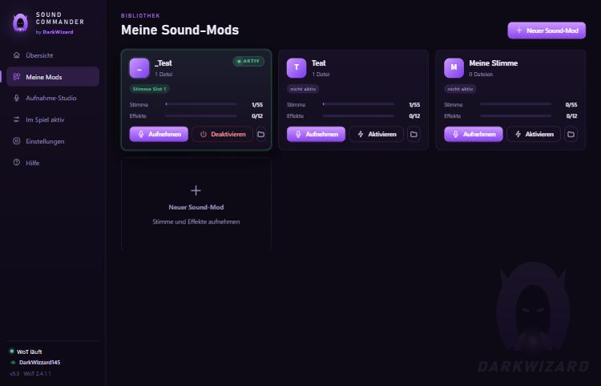

<p align="center"></p>

<h1 align="center">Hexcall</h1>
<p align="center"><b>Eigene Commander-Stimme und eigene Effekte für World of Tanks</b><br>
Mit dem Mikrofon aufnehmen, mit einem Klick im Spiel aktivieren. Ohne Wwise.</p>

<p align="center"><a href="../../releases/latest"><b>⬇ Neueste Version herunterladen</b></a></p>



## Funktionen

- **Aufnahme-Studio:** alle 55 Commander-Ansagen Schritt für Schritt mit dem Mikrofon einsprechen, mit Überspringen, Varianten und Drag & Drop (WAV, MP3, M4A, OGG)
- **Effekte:** Kanone, Motor, Turm, Ketten, Explosionen, Feuer, getrennt für den eigenen Panzer und für andere
- **Saubere Aufnahmen:** Stille und Klicks werden automatisch entfernt, die Lautstärke wird angeglichen
- **Zwei Stimmen im Spiel umschaltbar** über die Option „nationale Besatzungsstimmen“
- **Ein-Klick-Updates:** Der Client prüft beim Start, ob es eine neue Version gibt
- Drei Designs: DarkWizard, Commander und Hell

## Installation

1. Unter [Releases](../../releases/latest) den **Installer** (`Hexcall-Setup-x.y.z.exe`) oder das **ZIP** laden.
2. Installer ausführen, oder das ZIP entpacken und `Hexcall.vbs` starten.
3. Windows zeigt eventuell „Der Computer wurde durch Windows geschützt“, weil das Programm nicht signiert ist. Dann auf **Weitere Informationen → Trotzdem ausführen** klicken.

Voraussetzungen: Windows 10/11, Microsoft Edge (vorinstalliert), World of Tanks (EU/NA/ASIA-Client von Wargaming).
Node.js ist im Download enthalten.

## Datenschutz

- Alles läuft lokal. Es werden keine Daten verschickt.
- Die einzige Internetverbindung ist die Update-Prüfung bei GitHub.
- Deine Mods liegen in `%APPDATA%\Hexcall`.
- Der WoT-Spielername wird nur lokal aus der WoT-Einstellungsdatei angezeigt.

## Hinweise

- Es werden keine Dateien von Wargaming mitgeliefert. Die Sound-Banken entstehen auf deinem PC aus deiner eigenen WoT-Installation.
- Nach einem WoT-Update im Client einmal **Anwenden** klicken.
- Sound-Mods sind nach den Mod-Regeln von Wargaming erlaubt. Nutzung auf eigene Verantwortung.
- Dies ist ein Fan-Projekt und steht in keiner Verbindung zu Wargaming.

## Für Entwickler

```
node tools\release.js     # baut dist\ (ZIP mit Node, SHA256SUMS, Installer falls Inno Setup installiert)
node tools\docs.js        # erzeugt Anleitung.html, Sprachliste.html und die Download-Seite (docs\)
```

Release: Version in `version.json` erhöhen, Tag `vX.Y.Z` pushen. Der GitHub-Workflow baut und veröffentlicht automatisch.

---
<sub>a DarkWizard production</sub>
