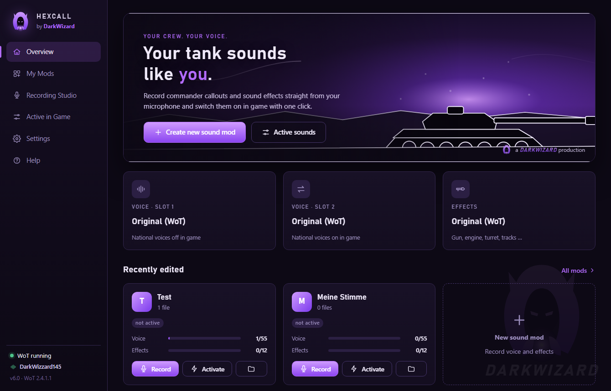

<p align="center"></p>

<h1 align="center">Hexcall</h1>
<p align="center"><b>Your own commander voice and sound effects for World of Tanks</b><br>
Record with your microphone, switch on in game with one click. No Wwise needed.</p>

<p align="center"><a href="../../releases/latest"><b>⬇ Download the latest version</b></a> · <a href="https://d4rkwizard.github.io/hexcall/">Website</a></p>



## Features

- **Recording studio:** record all 55 commander callouts step by step with your microphone – with skip, variants and drag & drop (WAV, MP3, M4A, OGG)
- **Effects:** gun, engine, turret, tracks, explosions and fire – separately for your own tank and for others
- **Clean recordings:** silence and clicks are removed automatically, the volume is levelled
- **Two voices in game:** one for the WoT voice-over "Standard", one for "Commander"
- **Reload button:** see at a glance whether your selection is already in the game; restart WoT from the client when needed
- **Updates:** the client checks for new versions on start and updates with one click (optionally automatic)
- **6 languages:** English, German, Russian, Polish, French, Spanish
- Three themes: DarkWizard, Commander and Light

## Installation

1. Download the **installer** (`Hexcall-Setup-x.y.z.exe`) or the **ZIP** from [Releases](../../releases/latest).
2. Run the installer, or unzip the ZIP and start `Hexcall.vbs`.
3. Windows may show "Windows protected your PC" because the program is not signed. Click **More info → Run anyway**.

Requirements: Windows 10/11, Microsoft Edge (pre-installed), World of Tanks (Wargaming client EU/NA/ASIA).
Node.js is included in the download.

See the [guide](https://d4rkwizard.github.io/hexcall/guide.html) and the [line list](https://d4rkwizard.github.io/hexcall/lines.html) for details.

## Privacy

- Everything runs locally. No data is sent anywhere.
- The only internet connection is the update check on GitHub.
- Your mods are stored in `%APPDATA%\Hexcall`.
- The WoT player name is only shown locally, read from the WoT settings file.

## Notes

- No Wargaming files are distributed. The sound banks are built on your PC from your own WoT installation.
- After a WoT update, Hexcall shows a notice – click **Turn sounds back on**.
- Sound mods are allowed under Wargaming's mod rules. Use at your own risk.
- This is a fan project and not affiliated with Wargaming.

## For developers

```
node tools\release.js     # builds dist\ (ZIP with Node, SHA256SUMS, installer if Inno Setup is installed)
node tools\docs.js        # generates the guide and line list (EN + DE) and the download page (docs\)
```

Release: bump the version in `version.json`, push a tag `vX.Y.Z`. The GitHub workflow builds and publishes automatically.

---
<sub>a DarkWizard production</sub>
